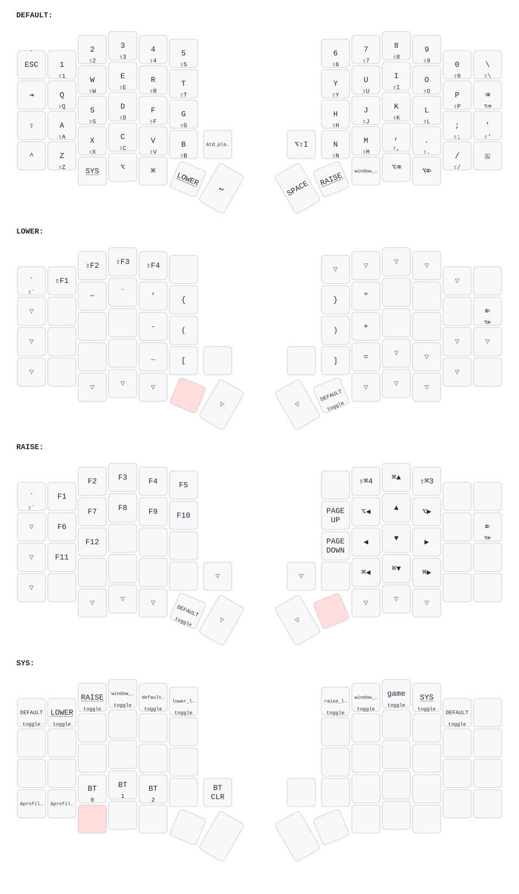
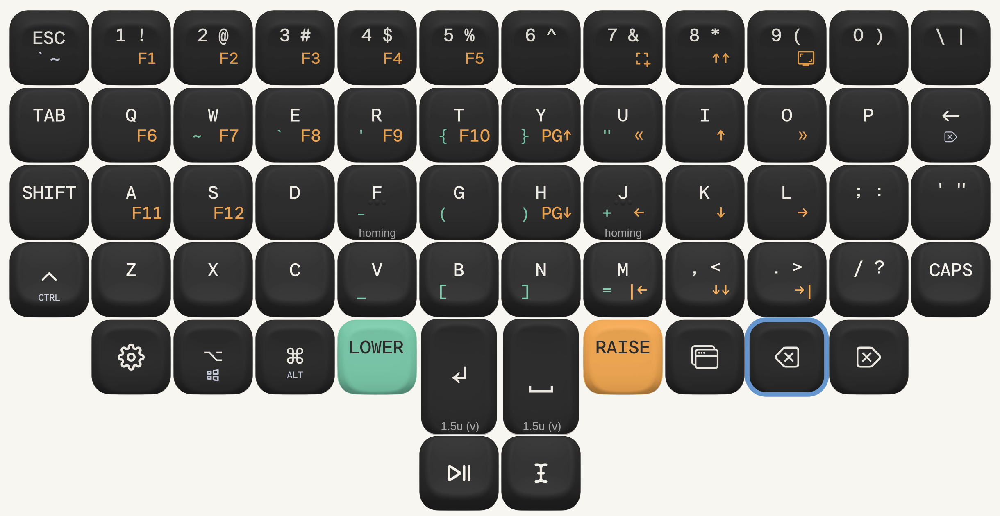

# ZMK Config for Sofle Choc Wireless
Board: [Sofle Choc Wireless](https://github.com/db-ok/SofleChocWireless) with [nice!view](https://nicekeyboards.com/nice-view/) displays & [nice!nano]() controllers

Dongle: [nrfMicro](https://github.com/joric/nrfmicro) (v1.3) with OLED Dispaly

# Additions/Fixes
* Custom 'sofled' board/shield for Sofle with Dongle

# Layout

# Keycaps
KLP Lamé (choc) set from the [Yuzu playground](https://yuzukeycaps.com/playground). Import [`keycaps/Sofle60.json`](keycaps/Sofle60.json) to edit.

